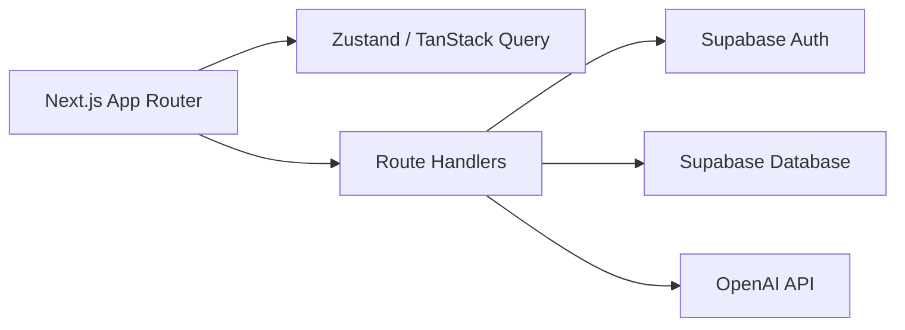

# MAGO

사용자가 선택한 타로 카드와 고민을 바탕으로 개인화된 AI 리딩을 제공하는 웹서비스입니다.

**2026.06 ~ 진행 중 · 개인 프로젝트**  
기획·디자인·프론트엔드·서버 로직·운영

[서비스 바로가기](https://magotarot.kr)


## 기술 스택

- **Frontend:** Next.js, React, TypeScript, Zustand, TanStack Query
- **Styling:** Emotion, Framer Motion
- **Server:** Next.js Route Handlers, Supabase Auth·Database
- **AI:** OpenAI Responses API, Structured Outputs
- **Analytics:** Google Analytics 4

## 애플리케이션 구조



- **Server Components:** 초기 데이터 조회와 SEO 메타데이터 생성
- **Client Components:** 카드 선택, 애니메이션, 사용자 상호작용
- **Route Handlers:** 인증·입력 검증 및 OpenAI·Supabase 연동
- **Zustand:** 타로 진행 상태, 언어, 엽전 상태 관리
- **TanStack Query:** 결과 데이터 캐시와 리뷰 상태 동기화

## 주요 기능


- 3·5·7장 타로 카드 선택 및 AI 리딩 생성
- 이메일·카카오 로그인과 동일 이메일의 기존 계정 연결
- 리딩 결과 저장·공유·히스토리 조회·삭제
- 출석·추천인 보상 및 리딩 이용에 따른 엽전 차감
- 78장 타로 카드 백과사전과 카드별 상세 페이지
- 반응형 UI와 검색엔진 최적화

## 핵심 기술적 문제 해결

### 1. AI 리딩 응답시간 개선

서버 처리 구간을 측정해 전체 처리시간의 약 **98.8%가 OpenAI 응답 대기에서 발생**하는 것을 확인했습니다.

카드 선택 중 개별 해석을 미리 생성하고, 마지막 카드 선택 시 남은 해석과 최종 종합을 병렬 처리하도록 변경했습니다. 개발 환경 반복 측정에서 3장 리딩 시간을 **14.89초에서 11.17초로 약 25% 단축**했습니다.

> OpenAI 응답시간에 따른 편차가 존재하며, 11.17초는 최종 대표 측정 2회의 평균입니다.

[PR #14 – 타로 리딩 응답 속도와 진행 경험 개선](https://github.com/BugEliminator/mago/pull/14)

### 2. AI 요청의 신뢰 경계 강화

클라이언트가 전달한 사용자·카드 정보를 그대로 사용하지 않고, 인증된 사용자 정보와 카드 데이터를 서버에서 다시 조회하도록 구성했습니다.

OpenAI 응답에는 카드 수에 맞춘 Strict JSON Schema를 적용하고, 병렬 처리나 응답 조립이 실패하면 기존 단일 요청 방식으로 복구하도록 처리했습니다.

### 3. 카카오 로그인과 기존 계정 연결

Supabase Auth·SSR과 OAuth PKCE 방식으로 카카오 로그인을 구현했습니다.

OAuth 콜백에서 인증 세션을 생성한 뒤 카카오 계정의 이메일로 기존 프로필을 조회하고, 일치하는 계정이 하나인 경우 서버 RPC를 통해 identity를 연결하도록 구성했습니다. 연결 후에는 기존 계정의 리딩 기록과 재화를 이어서 사용할 수 있습니다.

### 4. 결과 저장의 부분 실패 처리

리딩 정보와 선택 카드 정보를 분리해 저장하고, UUID 기반으로 로그인 없이 결과를 공유할 수 있도록 구현했습니다.

카드 정보 저장이 실패하면 먼저 생성된 리딩 데이터를 삭제하는 보상 처리를 적용해 불완전한 결과가 남지 않도록 했습니다.

### 5. 사용자별 진행 상태 관리

Zustand와 사용자별 `localStorage` 키를 활용해 카드 선택 도중 새로고침해도 진행 상태가 복원되도록 구현했습니다.

로그인 사용자가 변경되면 저장 데이터의 소유자를 확인하고 상태를 초기화해, 이전 사용자의 임시 데이터가 노출되지 않도록 처리했습니다.

## UI/UX 및 SEO

- Emotion SSR과 Framer Motion을 활용한 카드 선택·전환 애니메이션
- 모바일 터치와 휠 입력을 고려한 반응형 카드 인터랙션
- 진행률과 단계별 안내를 제공해 AI 응답 대기 경험 개선
- canonical·Open Graph·Twitter 메타데이터와 sitemap·robots 구성
- 78장 카드 상세 페이지의 동적 메타데이터 및 구조화 데이터 적용

## 로컬 실행

```bash
yarn install
yarn dev
```

핵심 기능 실행에 필요한 환경변수:

```env
NEXT_PUBLIC_SUPABASE_URL=
NEXT_PUBLIC_SUPABASE_ANON_KEY=
SUPABASE_SERVICE_ROLE_KEY=
OPENAI_API_KEY=
NEXT_PUBLIC_SITE_URL=
```

기능에 따라 다음 환경변수도 사용합니다.

```env
MAGO_MODEL=
DELETED_USERS_HASH_SECRET=
NEXT_PUBLIC_GA_MEASUREMENT_ID=
```

환경변수 값과 API 키는 저장소에 포함하지 않습니다. 전체 기능 실행에는 별도의 Supabase 스키마와 Storage 설정이 필요합니다.

## 향후 계획

- 엽전 충전 및 결제 기능
- 상점과 인벤토리 기능
- 다국어 리딩 지원
